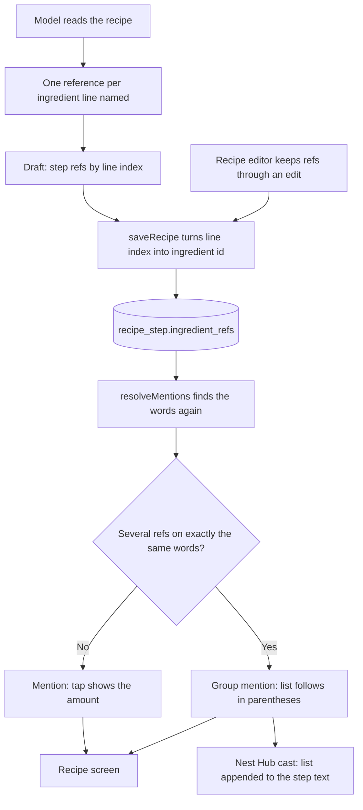

# Ingredients named in a step

How a preparation step's words get linked to the recipe's ingredient lines, and
what the cook sees. A single word ("tomaatit") reveals its amount on tap, as
since #120. A group phrase ("kuivat aineet") is the same kind of link repeated:
one reference per line, all on the same words, and the screen lists the whole
group in parentheses after the phrase (#376).

## Colours

- **violet**: the model's part, on import
- **blue**: the saved shape and the paths that write it
- **teal**: matching the stored words to today's step text
- **green**: what the cook sees, unchanged by #376
- **amber**: new in #376

## Boxes

- **One reference per ingredient line named**: the import prompt in `src/intake.ts` (the `ingredient_refs` rules). #376 adds: a phrase that names a group gets one reference per line in the group, all with the same `matched_text` and `approx_position`.
- **saveRecipe turns line index into ingredient id**: `src/recipe-save.ts::ingredientForRef`, unchanged; each reference of a group is converted on its own.
- **(recipe_step.ingredient_refs)**: JSON list of `StepIngredientRef`, unchanged shape; a group is several entries with the same `matchedText`.
- **resolveMentions finds the words again**: `src/ingredient-refs.ts::resolveMentions`.
- **Several refs on exactly the same words?**: new in #376. References landing on the identical span join into one group segment with several ingredient ids. A partial overlap is still a clash: the later reference is dropped as stale.
- **Group mention: list follows in parentheses**: `src/recipes.ts::stepText` renders "kuivat aineet (3 dl vehnäjauho, 2 tl leivinjauhe, ½ tl suola)", always visible, in ingredient-list order. The list text is `src/ingredient-refs.ts::groupListText`, shared with the cast.
- **Nest Hub cast: list appended to the step text**: `src/cast.ts::castStepText`, which sends plain strings.
